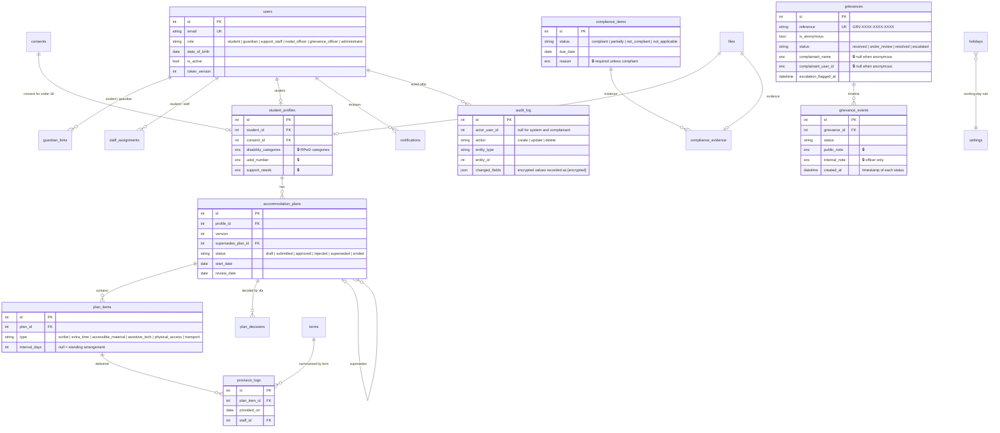

# Data model

Core entities. Columns marked 🔒 are encrypted at rest (AES-256-GCM). Every table also has `id` and `created_at`. Tables marked ✍ are append-only: the database refuses UPDATE and DELETE.

## Rules that the schema alone does not enforce

- A plan is **active** only when `status = approved` and `start_date` has arrived. Approval writes a `plan_decisions` row first.
- Changing an approved plan creates a new `draft` version; the old one is `superseded` only when the new one is approved.
- An under-18 student has no `student_profiles` row until a `consents` row exists (checked in the API, returns `consent_required`).
- Grievance status moves `received → under_review → resolved | escalated` (and `escalated → resolved`); each step adds a `grievance_events` row with its timestamp.
- Escalation is flagged after more than the configured number of working days under review, using Monday–Saturday by default and the holiday table.
